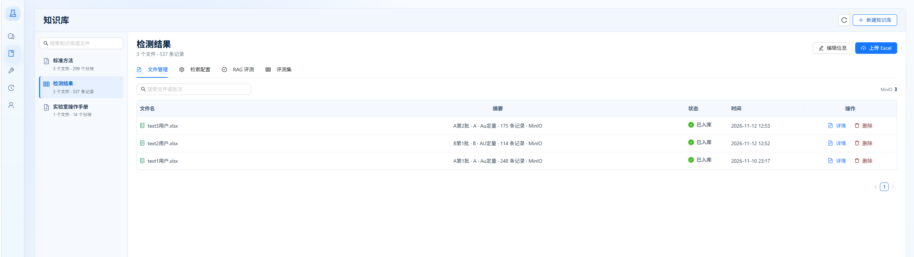
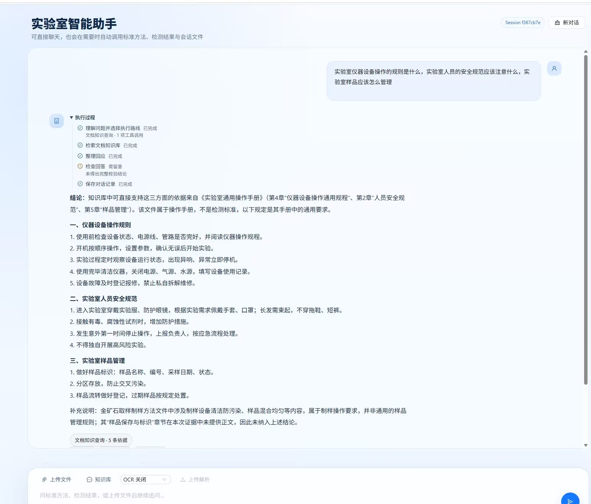
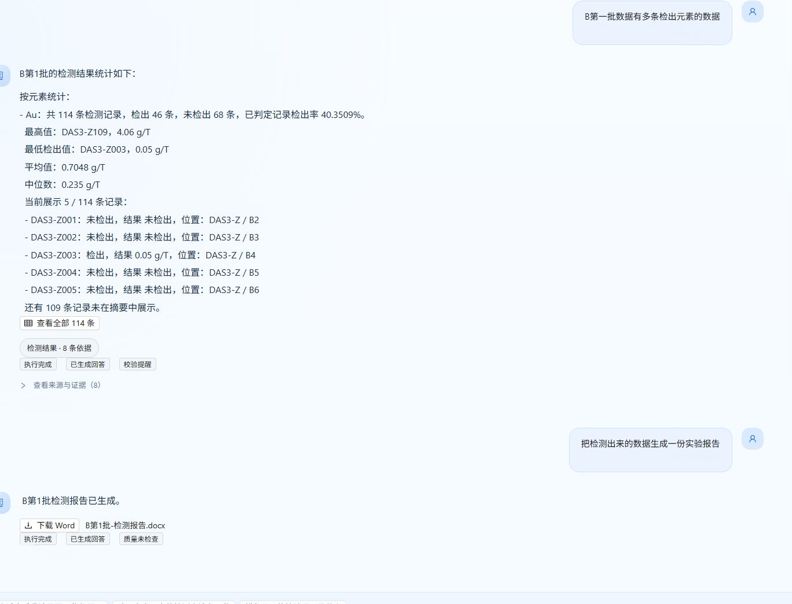
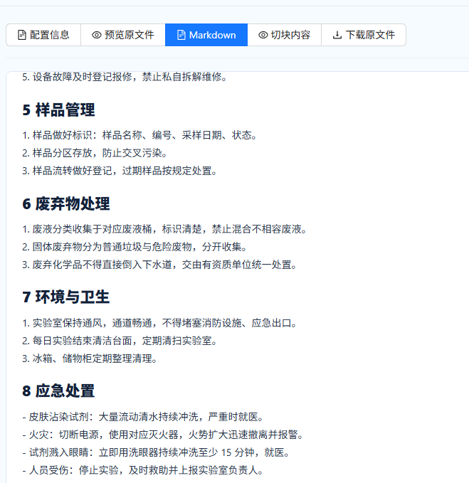
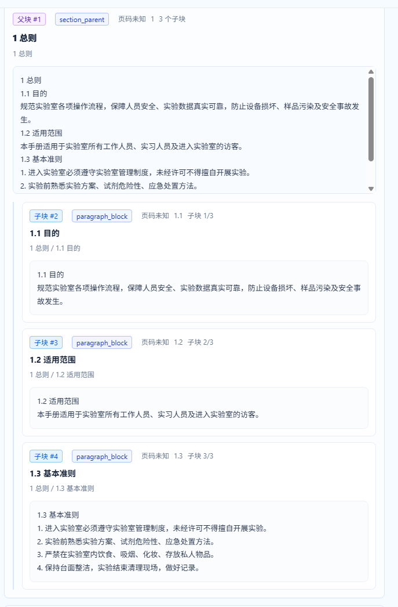
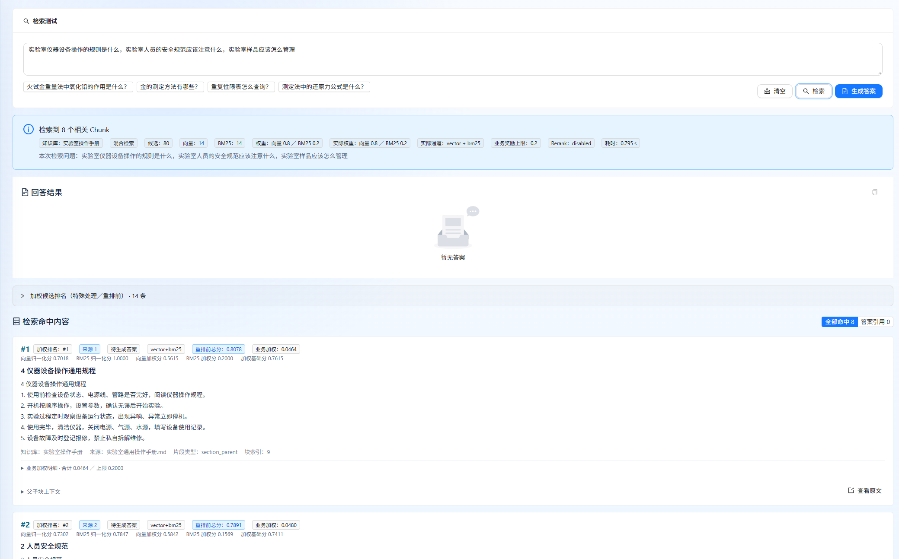
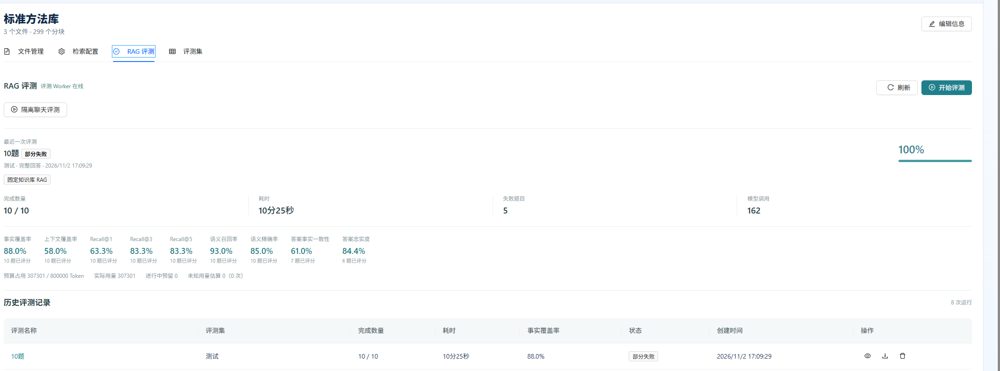
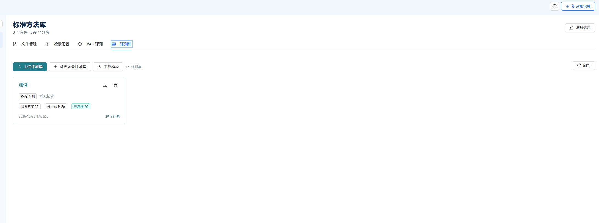
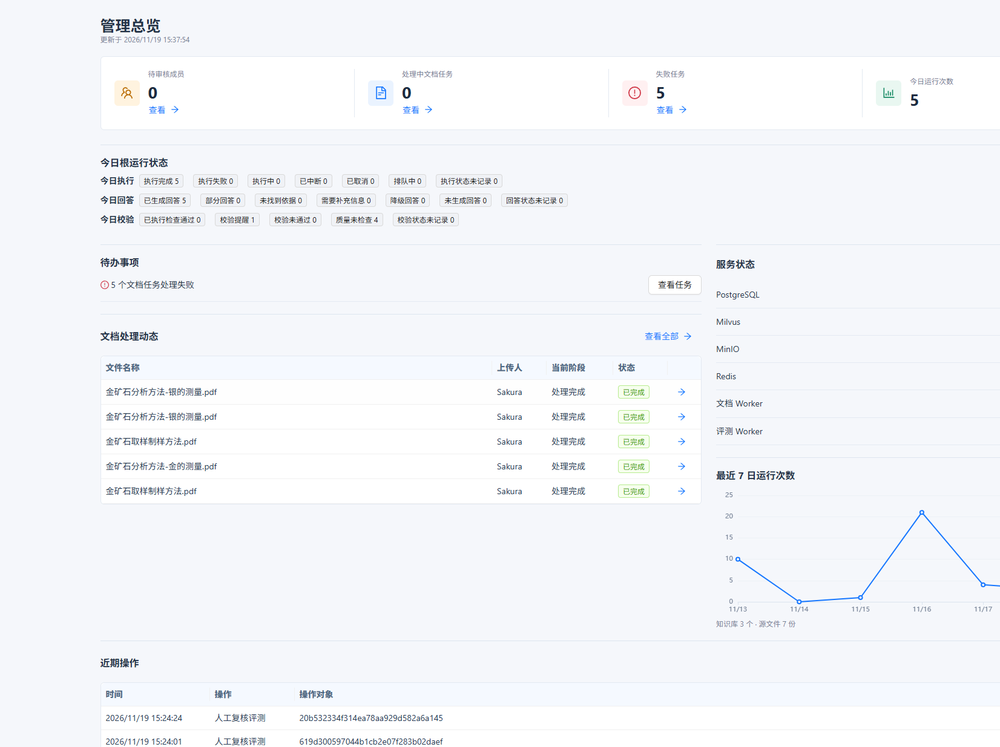

# 实验室智能助手 | Laboratory Agent

连接实验室文档、Excel 检测数据与 Word 报告生成的 Agent 应用。

**Vue 3 · FastAPI · LangGraph · PostgreSQL · Milvus · MinIO · Redis**

> 本仓库用于项目展示与面试交流，不包含应用源码、密钥或内部部署配置。

## 项目概览

实验室问题并不只有文档问答：标准方法需要查原文，Excel 检测结果需要精确统计，报告则需要在确认记录范围后按模板生成。

本项目以聊天为统一入口，通过 Agent 编排分别调用文档检索、结构化数据查询和报告工具。模型负责理解需求与组织表达，后端负责数据筛选、计算、校验及文件生成。

## 功能一览

| 模块 | 核心能力 | 结果与可观察信息 |
| --- | --- | --- |
| 智能问答 | 文档检索、会话上下文与工具路由 | 回答、执行状态、来源入口 |
| Excel 查询与报告 | 批次筛选、检出统计、范围确认与模板导出 | 记录明细、统计结果、Word 下载 |
| 知识库管理 | 标准方法、结果数据与操作手册分库 | 文件、数量、入库与解析状态 |
| 文档解析 | 原文件、Markdown、章节父子块 | 原文内容、结构关系与位置 |
| 检索测试 | 向量与 BM25 召回、融合与可选重排 | 通道、候选排名、权重及命中正文 |
| RAG 评测 | 评测集与历史运行管理 | 分项指标、失败题目与调用用量 |
| 管理总览 | 文档任务、服务组件与运行状态 | 待处理事项、异常状态与近期操作 |

## 界面与功能展示

### 知识库管理

标准方法、检测结果与操作手册分库管理。双栏页面展示当前知识库的文件、记录数量和入库状态。

[](assets/knowledge.png)

### 智能问答与报告

<details>
<summary><strong>智能问答：查看执行过程与回答来源</strong></summary>

一次问题可以包含仪器操作、安全规范和样品管理等多个主题。主对话展示工具执行步骤、回答及来源入口；执行状态、回答状态和校验状态分别保留。

[](assets/chat.png)

</details>

<details>
<summary><strong>Excel 数据查询：从检出统计到 Word 报告</strong></summary>

自然语言查询获得批次统计，并在明确目标与范围后生成报告。截图展示了一次结果查询及后续报告下载入口。

- 筛选范围支持整批、仅检出、原表顺序前 N 条及手动勾选。
- N 使用用户指定的数量，不固定为 10 条。
- 统计由后端工具计算，报告由模板生成，不由模型直接猜测记录数量。
- 生成文件不代替人工审核或正式签发。

[](assets/report.png)

</details>

### 文档解析与检索检查

<details>
<summary><strong>解析产物：Markdown 与章节父子块</strong></summary>

支持分别查看原文件、Markdown 和切块内容。章节父块与段落子块保持结构关系，方便检查解析是否完整，以及命中片段是否缺少正文。

**解析后的 Markdown**

[](assets/markdown.png)

**章节父块与段落子块**

[](assets/chunks.png)

</details>

<details>
<summary><strong>检索测试：召回通道、候选排名与原文</strong></summary>

展示实际召回通道、向量与 BM25 候选信息、融合权重及命中内容。截图处于检索后、答案生成前，召回与答案生成可以分别检查。

候选数量、最终送模预算与输出上限是不同约束。增加 Top K 或输出 token，不能自动恢复已经丢失的正文或保证问题覆盖。

[](assets/retrieval.png)

</details>

### 评测与运行管理

<details>
<summary><strong>RAG 评测：评测集、分项指标与历史运行</strong></summary>

评测集与历史运行独立管理，记录分项指标、失败题目和调用用量。

> 截图是一次运行记录，不作为项目总体准确率或性能证明。进度 100% 表示题目处理结束，不代表全部回答正确，也不代表全部评分成功。

**评测面板**

[](assets/evaluation.png)

**评测集管理**

[](assets/dataset.png)

</details>

<details>
<summary><strong>管理总览：任务、服务与运行状态</strong></summary>

汇集文档处理任务、运行状态、服务组件和近期操作。异常任务与校验提醒保留在界面中，便于继续排查，不将所有状态合并为一个成功标记。

[](assets/operations.png)

</details>

## 架构与技术栈

```text
Vue 3 前端 -> FastAPI -> LangGraph / Skills
                            |
                  文档检索 / Excel 查询 / 报告工具
                            |
           PostgreSQL / Milvus / MinIO / Redis / Worker
```

此图为职责关系示意，不代表部署拓扑或每次请求的完整执行轨迹。详见 [架构与工程设计](docs/architecture.md)。

| 层次 | 主要技术 |
| --- | --- |
| 前端 | Vue 3、TypeScript、Ant Design Vue、Pinia、Vite |
| 后端与编排 | FastAPI、SQLAlchemy、Pydantic、LangGraph、Skills、SSE |
| 数据与存储 | PostgreSQL / pgvector、Milvus、MinIO、Redis |
| 解析与文件生成 | MinerU / PaddleOCR、openpyxl、python-docx |
| 模型服务 | OpenAI 兼容接口 |

## 工程设计重点

1. **确定性计算与自然语言分工。** 模型提取意图和条件，业务代码完成筛选、统计及文件生成。
2. **证据覆盖与预算分离。** 区分候选数量与送模预算，关注正文、方法分组、重复证据和多问题覆盖。
3. **文档与向量一致性。** PostgreSQL 管理文档身份和有效状态，Milvus 提供向量检索，命中结果关联有效文档。
4. **长任务分阶段执行。** 文档和评测由独立 Worker 运行，区分失败、中断、取消及完成状态。
5. **报告范围可复核。** 确认记录后固定范围与快照，保持查询、选择和导出使用一致的数据口径。

## 当前边界

- 项目持续迭代，检索覆盖、回答质量及异常恢复仍需通过固定案例和实际场景验证。
- 当前报告针对单批次，不自动合并多个批次。
- 生成文件不代表完成审核、签名、盖章或授权签发。
- 展示材料不提供应用源码、运行包或生产部署保证。
- 截图中的单次运行、进度及评测指标，不作为未经验证的总体成果声明。
